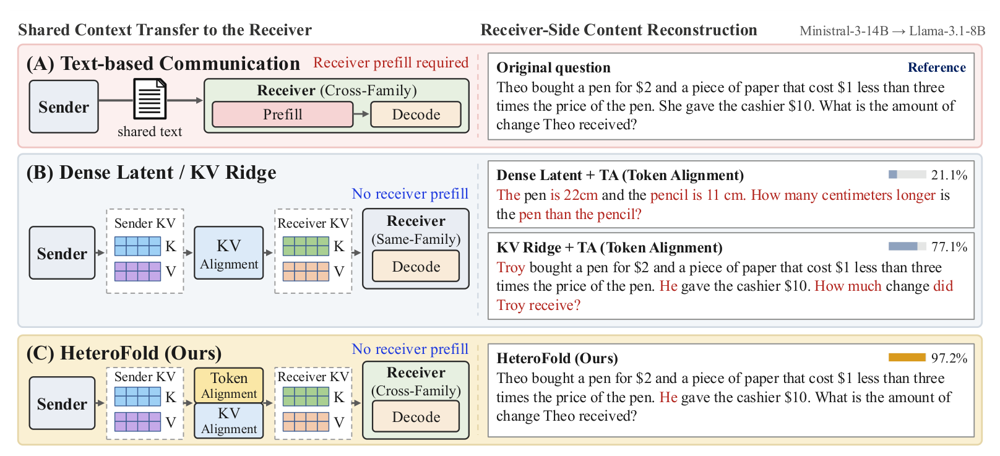
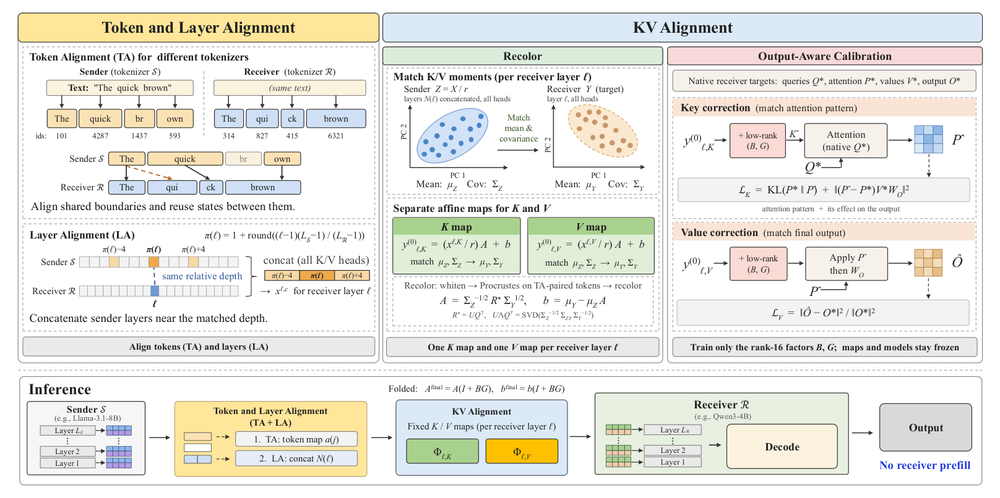

# Prefill-Free Cross-Family KV Cache Transfer for Heterogeneous Multi-Agent LLMs

Official implementation of **Prefill-Free Cross-Family KV Cache Transfer for Heterogeneous Multi-Agent LLMs** (HeteroFold).

[](https://arxiv.org/abs/2609.32259)
[](https://huggingface.co/papers/2609.32259)



## Overview

Multi-agent LLM systems increasingly combine models from different families. With
text-based communication, every receiver has to prefill the shared context that the
sender has already processed. Reusing the sender's key-value (KV) cache removes this
redundant prefill, but across model families the two caches differ in tokenization,
depth, and KV representation.



**HeteroFold** transfers the sender's KV cache to a receiver from another model family
while both models stay frozen, and the receiver never prefills the shared context.

1. **Token Alignment (TA)** pairs sender and receiver tokens that end at the same
   character boundary and forward-fills the positions in between.
2. **Layer Alignment (LA)** matches layers by relative depth and concatenates the
   sender layers at offsets -4, 0, +4 around the matched layer.
3. **Recolor** fits one closed-form affine map per receiver layer and role (K or V):
   whiten the sender features, rotate them with a Procrustes solution, and restore
   the receiver mean and covariance.
4. **Output-aware calibration** trains a rank-16 correction on top of Recolor so that
   the receiver's attention pattern and attention output match native prefill.
5. **Folding** merges the correction into the affine map. Inference uses one fixed
   map per receiver layer and role, with no extra module.

This repository contains the code for the main results of the paper (Table 1): it
fits the HeteroFold map of a transfer direction and evaluates it on the nine
benchmarks, together with the text-based reference in which the receiver prefills
the prompt natively (the TextMas rows).

## Installation

```bash
git clone https://github.com/daniel-eai/Prefill-Free-Multi-Agent-LLMs.git
cd Prefill-Free-Multi-Agent-LLMs

conda create -n heterofold python=3.12 -y && conda activate heterofold
pip install torch==2.9.1 --index-url https://download.pytorch.org/whl/cu128
pip install -r requirements.txt
```

All commands below are run from the repository root. The code runs in place;
`pip install -e .` is only needed if you want to import `heterofold` from elsewhere.

A quick check that needs no GPU and no model download:

```bash
python -m unittest discover -s tests
```

## Models

All models are frozen and loaded in BF16 at a pinned Hub revision.

| Alias | Hugging Face repository | Revision |
|---|---|---|
| `llama8` | `meta-llama/Llama-3.1-8B-Instruct` | `0e9e39f2` |
| `qwen4` | `Qwen/Qwen3-4B` | `1cfa9a72` |
| `ministral14` | `mistralai/Ministral-3-14B-Instruct-2512-BF16` | `3cea74c1` |

A transfer direction is written `<sender>_to_<receiver>`, for example
`llama8_to_qwen4`. The six directions of the paper are all ordered pairs of the
three models.

Llama-3.1 and Ministral-3 are gated. Accept their licenses on the Hub, then:

```bash
export HF_TOKEN=hf_your_token_here
```

To use a checkpoint that is already on disk, point the alias at its directory:

```bash
export HETEROFOLD_LLAMA8_PATH=/path/to/Llama-3.1-8B-Instruct
```

## Data

```bash
bash scripts/prepare.sh
```

This downloads the three models (about 50 GB) and prepares everything under
`data/` (about 0.5 GB):

| Output | Source | Use |
|---|---|---|
| `data/longbench/{qasper,hotpotqa}.jsonl` | `THUDM/LongBench` | evaluation, 200 items each |
| `data/quality/quality_dev.jsonl` | QuALITY v1.0.1 dev | evaluation, 2,086 questions |
| `data/locomo/locomo10_flat.jsonl` | LoCoMo, categories 1 to 4 | evaluation, 1,540 questions |
| `datasets` cache | ARC-Challenge, MMLU, WinoGrande, HellaSwag, GSM8K | evaluation |
| `data/calibration/openr1_hotpot.json` | Open-R1 Math and HotpotQA train | calibration, 2,000 prompts |

Every prepared file is checked against a SHA-256 recorded in the code, and the
calibration set is checked against a pinned digest of its prompt sequence, so a
successful run of this step means you have the same data.

The calibration set is label-free and has 2,000 prompts, 1,600 for training and
400 held out. No gold answers or solutions are used.

- **Open-R1** (1,000 prompts, problem text only). Problems are taken in dataset
  order from `open-r1/OpenR1-Math-220k`: those from the AMC/AIME source first, then
  those from olympiad sources, until 1,000 are collected. Every fifth problem is
  held out.
- **HotpotQA** (1,000 prompts, passages and question). Distractor training examples
  are drawn with seed 20260825. Questions and documents that appear in ARC-Challenge
  or the LongBench evaluation sets are excluded, and training and held-out prompts
  share no document.

## Running

### Quick start

One transfer direction, end to end:

```bash
GPUS=0 bash scripts/calibrate.sh llama8_to_qwen4
GPUS=0 bash scripts/evaluate.sh  llama8_to_qwen4 arc hotpotqa
```

`llama8_to_qwen4` is only an example. Any `<sender>_to_<receiver>` direction of the
three models is run the same way.

The first command fits the map and writes `maps/llama8_to_qwen4/heterofold.pt`.
The second evaluates the benchmarks listed after the direction one after another,
here ARC-Challenge and then HotpotQA, and prints the result table next to the
paper's numbers. List any of the nine benchmarks, or none to run all nine.

### Calibration

```bash
GPUS=0   bash scripts/calibrate.sh llama8_to_qwen4
GPUS=0,1 bash scripts/calibrate.sh llama8_to_ministral14
```

Give two GPU ids when the two models do not fit on one GPU. The script runs both
stages and writes to `maps/<pair>/`:

| File | Content |
|---|---|
| `recolor.pt` | Stage 1: TA + LA statistics and the closed-form Recolor map |
| `heterofold.pt` | Stage 2: the final folded map used for inference |
| `train_checkpoint.pt` | resume point; an interrupted run continues from here |
| `calibration_log.json` | settings and the held-out loss of every epoch |

Calibration needs no labels and no generated text. Both models only read the
2,000 calibration prompts.

### Evaluation

HeteroFold transfer on all nine benchmarks, sharded over four GPUs:

```bash
GPUS=0,1,2,3 bash scripts/evaluate.sh llama8_to_qwen4
```

A subset of benchmarks:

```bash
GPUS=0,1,2,3 bash scripts/evaluate.sh llama8_to_qwen4 arc hotpotqa quality
```

The text-based reference, in which the receiver prefills the prompt itself
(TextMas):

```bash
GPUS=0,1,2,3 bash scripts/evaluate.sh qwen4
```

Benchmark names are `qasper`, `hotpotqa`, `locomo`, `quality`, `arc`, `mmlu`,
`winogrande`, `hellaswag`, and `gsm8k`. Several names can be given in one command.
They are evaluated one after another with a single model load.

Results are written to `results/<pair>/heterofold/<benchmark>/items_<start>_<end>.json`
(and `results/<receiver>/native/...` for the reference). Each file stores the score
and the per-item predictions. Finished shards are skipped, so an interrupted
evaluation can simply be started again. To print the merged table at any time:

```bash
python -m heterofold summarize --results results --paper
```

In the transfer runs the sender reads the shared context once, its KV cache is
mapped by HeteroFold, and the receiver only processes its chat-template tokens and
the answer cue before decoding. The receiver never reads the context as text.

## Experimental configuration

| Setting | Flag | Paper value |
|---|---|---|
| Token correspondence | | Token Alignment: shared character boundaries, forward fill |
| Sender layers per receiver layer | `--span`, `--stride` | 3 layers at offsets -4, 0, +4 (span 1, stride 4) |
| Correction rank | `--rank` | 16 |
| Epochs | `--epochs` | 4, best held-out epoch kept |
| Optimizer | `--lr` | AdamW, learning rate 3e-4, weight decay 1e-4 |
| Prompts per optimizer step | `--grad-accum` | 8 |
| Gradient clipping | `--grad-clip` | 1.0 |
| Key output-loss weight | `--lambda-k-output` | 1.0 |
| Calibration prompts | | 1,600 train / 400 held-out, half Open-R1 and half HotpotQA |
| Seed | `--seed` | 20260825 |
| Precision | | BF16 models and maps; Recolor is fitted in FP32 |

The defaults of `python -m heterofold calibrate` are the paper values, so the
scripts need no extra flags.

## Benchmarks and metrics

| Suite | Benchmark | Items | Metric | Decoding |
|---|---|---:|---|---|
| Long context | Qasper (LongBench) | 200 | token F1 | sampling, T = 0.6, top-p 0.95, top-k 20, 128 new tokens |
| | HotpotQA (LongBench) | 200 | token F1 | same sampling, 32 new tokens |
| | LoCoMo | 1,540 | stemmed token F1 | greedy, 64 new tokens |
| | QuALITY | 2,086 | accuracy | likelihood of the option letter |
| Short context | ARC-Challenge | 1,172 | accuracy | likelihood of the option label |
| | MMLU | 14,042 | accuracy | likelihood of the option letter |
| | WinoGrande | 1,267 | accuracy | length-normalized option likelihood |
| | HellaSwag | 10,042 | accuracy | length-normalized ending likelihood |
| | GSM8K | 1,319 | accuracy | greedy, up to 4,096 new tokens |

Qwen3 runs in non-thinking mode. Sampling uses the seed `1001 + item index`, so
sampled benchmarks are repeatable on the same hardware.

## Results

Table 1 of the paper: HeteroFold and the text-based reference (TextMas, native
receiver prefill) for the six transfer directions. Qasper, HotpotQA and LoCoMo
report F1; the other benchmarks report accuracy. `scripts/evaluate.sh` prints the
matching row next to your numbers.

| Direction | Method | Qasper | HotpotQA | LoCoMo | QuALITY | ARC-C | MMLU | WinoGrande | HellaSwag | GSM8K |
|---|---|---:|---:|---:|---:|---:|---:|---:|---:|---:|
| Qwen3-4B → Llama-3.1-8B | TextMas | 44.64 | 57.54 | 52.33 | 75.07 | 82.76 | 66.74 | 65.82 | 70.78 | 85.67 |
| | **HeteroFold** | 29.12 | 38.48 | 29.66 | 62.85 | 78.92 | 63.28 | 57.30 | 65.60 | 55.12 |
| Ministral-3-14B → Qwen3-4B | TextMas | 43.07 | 56.05 | 38.92 | 70.61 | 87.80 | 67.95 | 55.09 | 41.54 | 90.14 |
| | **HeteroFold** | 42.00 | 52.74 | 35.59 | 75.55 | 88.99 | 72.14 | 53.83 | 41.46 | 89.23 |
| Llama-3.1-8B → Qwen3-4B | TextMas | 43.07 | 56.05 | 38.92 | 70.61 | 87.80 | 67.95 | 55.09 | 41.54 | 90.14 |
| | **HeteroFold** | 35.99 | 49.44 | 34.83 | 62.90 | 77.05 | 62.39 | 52.88 | 41.74 | 70.74 |
| Qwen3-4B → Ministral-3-14B | TextMas | 45.59 | 64.56 | 52.01 | 83.32 | 92.66 | 75.63 | 61.56 | 68.33 | 94.69 |
| | **HeteroFold** | 20.57 | 42.65 | 17.75 | 66.30 | 85.49 | 66.24 | 55.88 | 65.22 | 77.26 |
| Ministral-3-14B → Llama-3.1-8B | TextMas | 44.64 | 57.54 | 52.33 | 75.07 | 82.76 | 66.74 | 65.82 | 70.78 | 85.67 |
| | **HeteroFold** | 33.72 | 50.29 | 43.15 | 79.00 | 90.36 | 71.76 | 63.22 | 69.16 | 63.46 |
| Llama-3.1-8B → Ministral-3-14B | TextMas | 45.59 | 64.56 | 52.01 | 83.32 | 92.66 | 75.63 | 61.56 | 68.33 | 94.69 |
| | **HeteroFold** | 21.58 | 39.00 | 30.43 | 72.05 | 81.14 | 65.92 | 57.14 | 66.41 | 72.33 |

## Hardware

The code needs CUDA GPUs. It has been tested on NVIDIA A40, A100, H100 and
RTX 6000 Ada GPUs.

## Repository layout

```
.
├── heterofold/
│   ├── registry.py        pinned model checkpoints and pair naming
│   ├── modeling.py        model / tokenizer loading, chat-template handling
│   ├── alignment.py       Token Alignment (TA) and Layer Alignment (LA)
│   ├── capture.py         K/V capture from the sender and the native receiver
│   ├── recolor.py         Stage 1: aligned statistics and the Recolor map
│   ├── attention.py       receiver attention used by the calibration objective
│   ├── calibration.py     Stage 2: output-aware calibration and folding
│   ├── maps.py            map file format
│   ├── transfer.py        inference: sender cache -> receiver cache
│   ├── data/              benchmark download and the calibration set
│   ├── evaluation/        benchmark runners, scoring, result tables
│   └── cli.py             `python -m heterofold <command>`
├── scripts/
│   ├── prepare.sh         models and data
│   ├── calibrate.sh       fit the map of one direction
│   └── evaluate.sh        evaluate one direction or one native receiver
├── tests/                 CPU unit tests
└── assets/                figures
```

Using a map in your own code (run from the repository root):

```python
from heterofold.evaluation.runtime import Runtime, generate

runtime = Runtime(sender="llama8", receiver="qwen4",
                  map_path="maps/llama8_to_qwen4/heterofold.pt")

context = "Marie Curie won the Nobel Prize in Physics in 1903. Question: who won it?"
cache, length, _ = runtime.transfer_cache(context)
answer, _ = generate(runtime, runtime.suffix_ids(runtime.assistant), 32,
                     past_key_values=cache, past_length=length)
print(answer)
```

`transfer_cache` runs the sender on the context and maps its cache to the receiver.
`generate` then lets the receiver decode from that cache without reading the context.

`heterofold/transfer.py` holds the underlying steps (`capture_sender`,
`build_receiver_cache`) if you need the mapped cache without the evaluation runtime.

## Citation

If you find this work useful, please consider citing:

```bibtex
@article{yun2026heterofold,
  title={Prefill-Free Cross-Family KV Cache Transfer for Heterogeneous Multi-Agent LLMs},
  author={Yun, Vincent-Daniel and Lim, Woosang and Yoo, Haneul and Yoo, Sungjoo and Annavaram, Murali and Karimireddy, Sai Praneeth},
  journal={arXiv preprint arXiv:2609.32259},
  year={2026}
}
```
